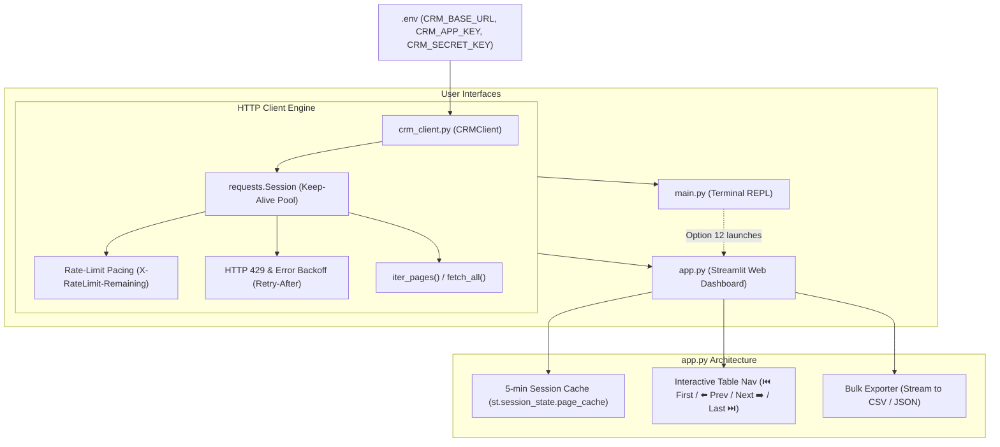

# Repository Guidelines

## Project Overview
The `api-query` repository is a lightweight Python exploration, inspection, and bulk-extraction tool for a remote CRM REST API (`crm.ilogo.id`). It provides two exploration modes backed by a shared, resilient API client:
- **Web Dashboard (`app.py`)**: An interactive Streamlit interface featuring in-memory TTL caching, interactive Next/Prev page browsing, tabular data manipulation via Pandas, and chunked bulk exports with progress bars.
- **Terminal Explorer (`main.py`)**: A command-line REPL for querying endpoints, viewing formatted JSON, saving outputs to disk, or spawning the web dashboard.

---

## Architecture & Data Flow



### Key Modules
1. **`crm_client.py` (`CRMClient`)**:
   - Single point of contact for external HTTP requests.
   - Manages connection pooling via a lazy `self.session` property (`requests.Session`).
   - Implements `iter_pages()` generator and `fetch_all()` convenience aggregator.
   - Enforces the server-side ceiling of $\le 100$ records per page.
2. **`app.py`**:
   - Streamlit dashboard with session state management.
   - Dual view: Pandas DataFrame via `pd.json_normalize` and collapsible JSON tree.
   - In-memory 5-minute TTL cache with LRU eviction (100-page cap) and live refresh bypass.
3. **`main.py`**:
   - Interactive terminal menu (choices 1–12).
   - Windows BOM sanitization and formatted JSON stdout printing.

---

## Key Directories
The project is intentionally structured as a flat, minimal Python project:
- **`.` (Root)**: All source modules (`crm_client.py`, `app.py`, `main.py`), configs, launcher, and docs.
- **`.venv/`**: Local Python virtual environment (ignored by Git; binaries in `.venv\Scripts\`).
- **`__pycache__/`**: Python bytecode artifacts (ignored by Git).

---

## Development Commands

### Environment Setup
```powershell
# Create virtual environment (Python 3.10+)
python -m venv .venv

# Install dependencies
.\.venv\Scripts\pip install -r requirements.txt
```

### Running the Application
```powershell
# Launch interactive dual-mode launcher (Windows)
.\run.bat

# Launch Streamlit Web Dashboard directly
.\.venv\Scripts\streamlit.exe run app.py

# Launch Terminal CLI Explorer directly
.\.venv\Scripts\python.exe main.py
```

### Linting, Compilation & Verification
```powershell
# Compile all source files to verify syntax
.\.venv\Scripts\python.exe -m py_compile app.py crm_client.py main.py

# Verify client configuration & auth loading via one-liner
.\.venv\Scripts\python.exe -c "from crm_client import CRMClient; c = CRMClient(); print('Configured:', c.is_configured())"
```

---

## Code Conventions & Common Patterns

### API Hard Limits & Constraints
- **Max `per_page` is 100**: The CRM API backend strictly validates `per_page <= 100`. Any value $> 100$ triggers `HTTP 422 Unprocessable Entity`. Input widgets must cap at `max_value=100`.
- **Rate Limit (60 req/min)**: The server returns `X-RateLimit-Limit: 60` and `X-RateLimit-Remaining: N`. Never flood the API with unthrottled concurrent requests.

### Formatting & Typing
- **PEP 8**: 4 spaces, snake_case for functions/variables, PascalCase for classes (`CRMClient`).
- **Type Annotations**: Explicit type hints on helper functions and client methods (e.g., `Generator[tuple[list[dict], dict, int, int], None, None]`, `Callable[[int, int, int, int | None], None]`, `str | int`).

### HTTP Client & Resilience Patterns
- **Connection Pooling**: Never instantiate bare `requests.get()` in a loop. Always route requests through `self.session.get()`.
- **Rate-Limit Pacing**: Inspect `resp.headers.get("X-RateLimit-Remaining")`. When $< 5$, pause execution (`time.sleep(2.0)`); otherwise maintain minimal pacing (`0.1s`).
- **HTTP 429 Exponential Backoff**: Catch status 429, inspect `Retry-After` header, and sleep before retrying up to 3 times:
  ```python
  if resp.status_code == 429:
      wait_time = int(resp.headers.get("Retry-After", 2 ** attempt))
      time.sleep(wait_time)
      continue
  ```

### Streamlit State Management & Caching Patterns
- **Widget Mutation Safety**: Never mutate a widget's session state key directly after widget instantiation. Always use button callbacks (`on_click=navigate_page, args=(target_page,)`) so state mutations occur *before* the script rerun:
  ```python
  def navigate_page(target_page: int):
      st.session_state.page_number = target_page
      st.session_state.trigger_fetch = True
  ```
- **In-Memory TTL Caching**: Cache keys are deterministic hashes of the endpoint path and sorted query parameter tuples. Stored as `(timestamp, meta, data)` with a 5-minute TTL:
  ```python
  def make_cache_key(endpoint: str, query_params: dict) -> str:
      sorted_items = sorted((str(k), str(v)) for k, v in (query_params or {}).items() if v is not None)
      return f"{endpoint.strip('/')}?{json.dumps(sorted_items)}"
  ```
- **Force Refresh**: Bypass cache by setting a flag (`st.session_state.force_refresh = True`) when the `🔄 Refresh` button is clicked, forcing a fresh API call and overwriting the cache entry.

### Terminal & Input Sanitization
- **Windows BOM Handling**: Always strip Windows Byte-Order-Mark (`\ufeff`) and trailing whitespace from user input:
  ```python
  def clean_input(prompt: str) -> str:
      return input(prompt).strip().replace("\ufeff", "")
  ```

---

## Important Files

| File Path | Role | Description |
| :--- | :--- | :--- |
| `crm_client.py` | Core Client | API client abstraction with session pooling, pagination generator, and retry backoff. |
| `app.py` | UI Entry Point | Streamlit dashboard, cache management, interactive navigation, and bulk exporter. |
| `main.py` | CLI Entry Point | Terminal REPL with menu-driven endpoint querying and JSON export. |
| `run.bat` | Windows Launcher | Interactive batch script checking `.venv` and dispatching UI or CLI. |
| `requirements.txt` | Dependencies | Pinned production dependencies (`requests`, `python-dotenv`, `streamlit`, `pandas`). |
| `.env.example` | Config Template | Template containing `CRM_BASE_URL`, `CRM_APP_KEY`, and `CRM_SECRET_KEY`. |
| `.env` | Active Config | Local environment credentials (Git-ignored). |
| `.gitignore` | Exclusion Rules | Protects `.env`, virtual environments (`.venv/`), and cache files. |
| `README.md` | Documentation | Quickstart guide, feature catalog, and manual execution commands. |

---

## Runtime/Tooling Preferences
- **Runtime**: Python 3.10+ (specifically Python 3.12 64-bit on Windows).
- **Package Manager**: Standard `pip` (no Poetry, Pipenv, or npm/Node required).
- **OS Platform**: Primary development on Windows (`win32` / Windows PowerShell / `run.bat`).
- **Synchronous Execution**: The codebase uses synchronous `requests` and Python generators. Avoid introducing `asyncio` or `aiohttp` unless explicitly requested.

---

## Testing & QA

### Testing Strategy
- The repository does not maintain a checked-in `tests/` directory; testing is performed via live smoke checks and headless evaluation.
- When adding or validating features, use the built-in headless **`streamlit.testing.v1.AppTest`** to simulate user interactions without launching a browser:

```python
from streamlit.testing.v1 import AppTest

# Headless integration test
at = AppTest.from_file("app.py", default_timeout=30)
at.run()
assert not at.exception

# Click Fetch Data
at.sidebar.button[0].click()
at.run()
assert at.session_state.last_meta["status_code"] == 200

# Test pagination button
next_btn = [b for b in at.button if "Next" in b.label][0]
next_btn.click()
at.run()
assert at.session_state.page_number == 2
```

### Client Unit Testing Pattern
When writing tests for `CRMClient`, mock `requests.Session.get` using `unittest.mock` to verify rate-limiting and 429 retries:
```python
import unittest
from unittest.mock import patch, MagicMock
from crm_client import CRMClient

class TestCRMClient(unittest.TestCase):
    @patch("requests.Session.get")
    def test_rate_limit_backoff(self, mock_get):
        resp_429 = MagicMock(status_code=429, headers={"Retry-After": "1"})
        resp_200 = MagicMock(status_code=200)
        resp_200.json.return_value = {"data": [], "meta": {"last_page": 1}}
        mock_get.side_effect = [resp_429, resp_200]

        client = CRMClient(base_url="https://crm.test/api/v1", app_key="k", secret_key="s")
        records, _ = client.fetch_all("organizations")
        self.assertEqual(mock_get.call_count, 2)
```
